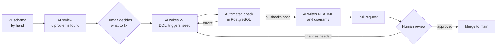

# Designing the database with an AI assistant

This document describes how version 2 of the schema was produced with **Claude** (Anthropic), working
as a coding agent in Claude Code. It covers what the AI did and what the human did,
how the result was checked, and what this approach is good and not so good at.

Back to the main documentation: [README.md](README.md).

---

## Contents

- [Starting point](#starting-point)
- [Roles: human and AI](#roles-human-and-ai)
- [Workflow](#workflow)
- [What the AI found in v1](#what-the-ai-found-in-v1)
- [Design decisions and trade-offs](#design-decisions-and-trade-offs)
- [How the result was verified](#how-the-result-was-verified)
- [Benefits of AI-assisted database modeling](#benefits-of-ai-assisted-database-modeling)
- [Limitations and risks](#limitations-and-risks)
- [Recommendations](#recommendations)

---

## Starting point

Version 1 was designed by hand: 11 PostgreSQL tables (servers, accounts, characters, classes,
abilities, guilds, guild members, ...) plus an ER diagram exported from a database tool.
It was already close to BCNF, but some business rules were not enforced, and one constraint
contradicted the data model.

The task for the AI was:

1. Review the v1 schema against the assignment (normal forms up to BCNF).
2. Find integrity problems and propose fixes.
3. Rewrite the DDL, add demo data and document the design in English.

---

## Roles: human and AI

| Step | Human | AI (Claude) |
|------|-------|-------------|
| Assignment and subject area | Chose MMORPG, designed v1 | — |
| Review of v1 | Read the findings, decided what to fix | Read the DDL and the diagram, listed 6 problems with explanations |
| Redesign | Approved the plan: "fix the schema as proposed" | Wrote `schema.sql` v2, triggers, indexes, `seed.sql` |
| Verification | Reviewed the diff and the pull request | Loaded schema and data into PostgreSQL, ran 9 negative tests and the example queries |
| Documentation | Asked for an English README with diagrams | Wrote README, Mermaid ER diagram, normalization analysis |
| Git | Approved each commit, push and merge | Created branch, commit, pull request; merged only on request |

The AI never merged or pushed anything on its own: every change went through a branch and a
pull request that the human reviewed and approved.

---

## Workflow

The whole cycle, from the first review to the merged pull request, took one working session.

---

## What the AI found in v1

| # | Problem | Why it matters |
|---|---------|----------------|
| 1 | `guild_members.character_id` was `UNIQUE`, but the table also had `left_at` | A character who left a guild could **never** join any guild again; the history the column suggested was impossible |
| 2 | Nothing linked the guild's server to the character's server | A character from one realm could join a guild on another |
| 3 | `character_abilities` was not checked against `class_abilities` | A warrior could learn a mage spell |
| 4 | `guilds.leader_character_id` was not tied to membership | The leader could be someone outside the guild |
| 5 | Guild rank was free text | `'Member'`, `'member'` and `'member '` would be three different ranks |
| 6 | Money in three nullable columns without checks | Negative or `NULL` balances; the same amount could be stored in several ways |

Problems 1–4 are hard to spot by reading table by table: each table is fine on its own,
the bug only appears when rules span two or three tables. This is where a systematic review helps most.

---

## Design decisions and trade-offs

The AI proposed options; the decisions below were made together and are documented so they can be challenged.

**Triggers instead of redundant columns.**
The usual trick for "ability must belong to the character's class" is to copy `class_id` into
`character_abilities` and use a composite foreign key. That column would depend on `character_id`
alone, which **breaks 2NF**, the core requirement of the assignment. v2 keeps the tables normalized and
enforces cross-table rules with four small PL/pgSQL triggers instead.

**Immutable server and class.**
The triggers are only reliable if a character cannot move to another server or change class
afterwards, so that is forbidden too. In a real game, a "server transfer" would be a separate,
explicit operation.

**Leader as a rank, not a column.**
Removing `leader_character_id` removes a circular dependency (a guild needs a leader, and the leader
needs a guild). A partial unique index allows at most one current leader per guild.

**One money column.**
`balance_copper` holds the amount in the smallest coin; gold and silver are computed.
One amount now has exactly one representation.

---

## How the result was verified

AI-generated SQL is only as good as its testing, so nothing was accepted on trust:

1. **Real PostgreSQL.** The schema and the demo data were loaded into PostgreSQL (PGlite, an in-memory build of
   the PostgreSQL engine), because no database server was installed on the machine.
2. **Negative tests.** Nine operations that must fail were executed, and every one of them was rejected
   with the expected error: wrong-class ability, cross-server guild, second leader, second active guild,
   class change, guild server change, negative balance, `left_at` before `joined_at`, invalid email.
3. **Example queries.** The query results shown in the README were copied from that run, not invented.
4. **Human review.** The full diff was reviewed in the pull request before merging.

---

## Benefits of AI-assisted database modeling

- **Speed.** Review, redesign, test data, verification and documentation took one session instead of several days.
- **Systematic review.** The AI checked every table and every relationship against the same rules
  (keys, functional dependencies, cross-table invariants), which is where people tend to get tired and miss things.
- **Explained reasoning.** Every finding came with a "why", so the review doubled as a lesson in
  normalization and integrity constraints, not just a list of fixes.
- **Several options, not one answer.** For each problem the trade-offs were laid out
  (for example trigger vs. redundant column vs. 2NF), and the human picked the solution.
- **Tests come for free.** Negative tests and demo data were written together with the schema,
  so every rule in the README has been checked to actually work.
- **Documentation stays in sync.** The ER diagram is Mermaid text next to the code, so it is updated in the
  same commit as the schema instead of being a screenshot that slowly goes out of date.
- **Good engineering habits by default.** Branch, small commits, pull request, review, merge:
  the AI worked through the normal Git workflow instead of editing `main` directly.

---

## Limitations and risks

- **The AI can be wrong.** It can produce SQL that looks correct and is not. Here this was handled by
  running everything on a real PostgreSQL engine and by human review; without that, the result should not be trusted.
- **It does not know the business.** Rules like "a character can never change class" are product decisions.
  The AI can propose them, but only a person who owns the product can confirm them.
- **Trade-offs need a human.** Triggers keep the model normalized but hide logic from someone reading only
  the tables; another team might prefer controlled denormalization. The AI explains both, it does not decide.
- **Test environment differs from production.** PGlite runs the real PostgreSQL engine, but performance,
  extensions and configuration of a production server were not tested.
- **Data privacy.** Schema and demo data are shared with the AI service. That is fine for an educational
  project; real customer data or confidential schemas need an approved setup.
- **Learning.** For a student, it is easy to accept a finished answer without understanding it.
  The value comes from reading the explanations and being able to defend every decision yourself.

---

## Recommendations

For anyone who wants to model a database with an AI assistant:

1. Design a first version yourself, then ask the AI to **review** it. You learn more, and the review is sharper.
2. Ask for the **reason** behind each change and for alternatives, not just a new script.
3. Require **negative tests**: for every rule, an insert or update that must fail.
4. Run the result on the **real database engine** you are going to use.
5. Keep diagrams and documentation **in the repository as text** (Mermaid, SQL comments) so they change together with the schema.
6. Let the AI work in a **branch with pull requests**, and review the diff before merging.
