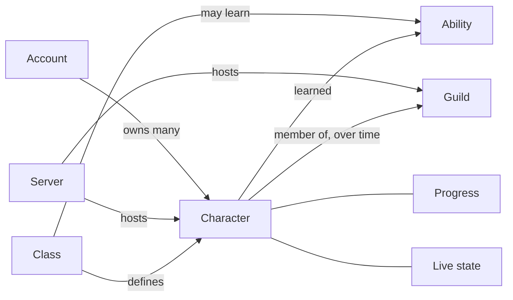
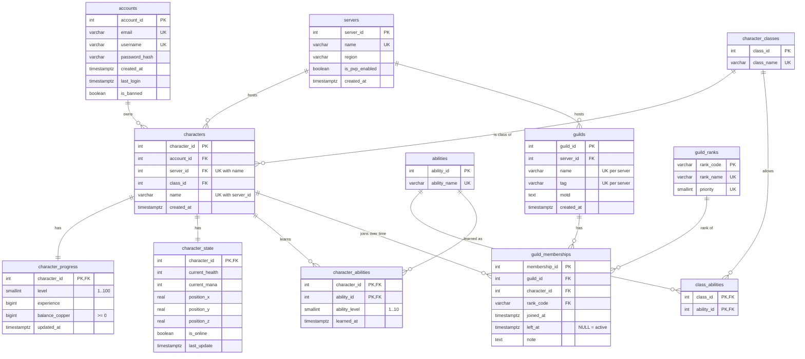

# bmtsu_MMORPG — Relational Database for an MMORPG


An educational database design for a massively multiplayer online role‑playing game:
servers, player accounts, characters, classes and abilities, guilds and membership history.

> **Assignment.** Pick a subject area (messenger, MMORPG, or a freight company) and design a
> database for it that follows the normal forms **up to and including Boyce–Codd normal form (BCNF)**.
> Deliver the `CREATE TABLE` script.
> This repository implements the **MMORPG** option.

---

## Contents

- [Repository structure](#repository-structure)
- [Quick start](#quick-start)
- [Domain model](#domain-model)
- [ER diagram](#er-diagram)
- [Tables](#tables)
- [Business rules and integrity](#business-rules-and-integrity)
- [Normalization (1NF → BCNF)](#normalization-1nf--bcnf)
- [Example queries](#example-queries)
- [What changed in v2](#what-changed-in-v2)

How AI (Claude) was used to review and redesign this schema is described in [AI_DESIGN.md](AI_DESIGN.md).

---

## Repository structure

| File | Purpose |
|------|---------|
| [`schema.sql`](schema.sql) | DDL: tables, constraints, triggers, indexes |
| [`seed.sql`](seed.sql) | Small demo dataset: 2 servers, 3 classes, 4 characters, 1 guild |
| `README.md` | This document |
| [`AI_DESIGN.md`](AI_DESIGN.md) | How the v2 schema was designed with an AI assistant (Claude), benefits and limits of the approach |

---

## Quick start

```bash
createdb mmorpg
psql -d mmorpg -f schema.sql -f seed.sql
```

Or with Docker, without installing PostgreSQL:

```bash
docker run --name mmorpg-db -e POSTGRES_PASSWORD=postgres -d postgres:16
docker cp schema.sql mmorpg-db:/schema.sql
docker cp seed.sql   mmorpg-db:/seed.sql
docker exec mmorpg-db psql -U postgres -f /schema.sql -f /seed.sql
```

Both scripts run inside a transaction, so a failure leaves the database untouched.

---

## Domain model



- A **player** has one **account** and can create many **characters**.
- Each character lives on one **server** (realm) and has one **class**. Both are chosen at creation and never change.
- A **class** defines which **abilities** a character may learn. Each learned ability has its own level.
- Long-term data (level, experience, money) and volatile data (health, mana, position, online flag) are kept in **separate 1:1 tables**. The volatile one is written many times per second, the long-term one rarely.
- **Guilds** exist on a single server. A character can be in one guild at a time, may leave and come back, and the **whole history** is stored.

---

## ER diagram



---

## Tables

| # | Table | What it stores | Key | Notable constraints |
|---|-------|----------------|-----|---------------------|
| 1 | `servers` | Game realms | `server_id` | unique `name` |
| 2 | `character_classes` | Warrior, Mage, … | `class_id` | unique `class_name` |
| 3 | `abilities` | Ability catalogue | `ability_id` | unique `ability_name` |
| 4 | `class_abilities` | Abilities allowed for a class (M:N) | (`class_id`, `ability_id`) | — |
| 5 | `guild_ranks` | Leader / Officer / Member | `rank_code` | unique `rank_name`, unique `priority` |
| 6 | `accounts` | Player accounts | `account_id` | unique `email`, unique `username`, email format check |
| 7 | `characters` | Player characters | `character_id` | unique (`server_id`, `name`); server and class are immutable |
| 8 | `character_progress` | Level, XP, money (1:1) | `character_id` | `level` 1–100, `experience` ≥ 0, `balance_copper` ≥ 0 |
| 9 | `character_state` | HP, mana, position, online (1:1) | `character_id` | `health`, `mana` ≥ 0 |
| 10 | `character_abilities` | Learned abilities and their level | (`character_id`, `ability_id`) | `ability_level` 1–10; must be allowed for the class |
| 11 | `guilds` | Guilds | `guild_id` | unique (`server_id`, `name`) and (`server_id`, `tag`) |
| 12 | `guild_memberships` | Membership periods (history) | `membership_id` | `left_at ≥ joined_at`; one active guild per character; one leader per guild |

### About money

v1 stored `gold`, `silver` and `copper` in three columns. That allowed values like *0 gold 250 silver*,
which mean the same as *2 gold 50 silver*, so one amount could be written in several ways.
v2 stores **one balance in the smallest coin** and derives the parts:

| Part | Formula | Example (1 534 299) |
|------|---------|---------------------|
| gold | `balance_copper / 10000` | 153 |
| silver | `balance_copper / 100 % 100` | 42 |
| copper | `balance_copper % 100` | 99 |

---

## Business rules and integrity

Rules inside one row are `CHECK` constraints. Uniqueness rules use (partial) unique indexes.
Rules that span tables use triggers, so the tables stay normalized and no data is duplicated.

| Rule | How it is enforced |
|------|--------------------|
| Character name is unique **per server** | `UNIQUE (server_id, name)` |
| Guild name and tag are unique per server | `UNIQUE (server_id, name)`, `UNIQUE (server_id, tag)` |
| A character is in **at most one guild at a time** | partial unique index `… (character_id) WHERE left_at IS NULL` |
| A character **can rejoin** a guild later | history rows: one row per membership period |
| A guild has **at most one current leader** | partial unique index `… (guild_id) WHERE rank_code = 'leader' AND left_at IS NULL` |
| A character joins only guilds **on its own server** | trigger `trg_guild_memberships_server` |
| A character learns only **abilities of its class** | trigger `trg_character_abilities_class` |
| Server and class of a character **never change** | trigger `trg_characters_immutable` |
| A guild never moves to another server | trigger `trg_guilds_immutable` |
| Level 1–100, ability level 1–10, money/HP/mana ≥ 0 | `CHECK` constraints |
| Deleting an account deletes its characters and their data | `ON DELETE CASCADE` |
| A server with characters or guilds cannot be deleted | `ON DELETE RESTRICT` |

Each rule was checked against the demo data. Every bad operation below is rejected:

```text
Warrior learns Fireball                -> Ability 3 is not available for the class of character 1
Nightfall character joins Aurora guild -> Character 2 and guild 1 are on different servers
Second active guild for a character    -> violates "uq_active_membership_per_character"
Second leader in a guild               -> violates "uq_active_leader_per_guild"
Change character class                 -> Character 1 cannot change server or class
Move guild to another server           -> Guild 1 cannot change server
Negative balance                       -> violates check "character_progress_balance_copper_check"
left_at earlier than joined_at         -> violates check "guild_memberships_check"
Invalid email                          -> violates check "accounts_email_check"
```

---

## Normalization (1NF → BCNF)

### 1NF — atomic values, no repeating groups
- Every column holds one value. Lists like "abilities of a character" or "members of a guild"
  are separate rows in `character_abilities` and `guild_memberships`, not comma-separated strings.
- Position is split into `position_x`, `position_y`, `position_z`.
- Every table has a primary key.

### 2NF — no partial dependency on a composite key
Only two tables have composite keys:

| Table | Key | Non-key attributes | Depend on the **whole** key? |
|-------|-----|--------------------|------------------------------|
| `class_abilities` | (class_id, ability_id) | — | n/a |
| `character_abilities` | (character_id, ability_id) | ability_level, learned_at | Yes, the level of *this* ability for *this* character |

There is deliberately **no `class_id` in `character_abilities`**. It would depend on `character_id` alone,
which breaks 2NF. The "ability must match the class" rule is a trigger instead.

### 3NF — no transitive dependencies
- Class name, ability name and rank name are stored once in reference tables and referenced by key.
  v1 stored the rank as free text in every membership row.
- Gold, silver and copper are not stored separately. They are computed from `balance_copper`.
- `guilds` has **no `leader_character_id`**. The leader is derived from `guild_memberships`
  (`rank_code = 'leader'`), so the "leader" fact lives in one place only.
- `characters` stores `server_id`; memberships don't. The server of a membership is derived through
  the character or the guild, so it is never stored twice.

### BCNF — every determinant is a candidate key
Non-trivial functional dependencies and their determinants:

| Table | Determinant(s) | Candidate key? |
|-------|---------------|----------------|
| `servers` | `server_id`, `name` | Yes, both |
| `accounts` | `account_id`, `email`, `username` | Yes, all three |
| `characters` | `character_id`, (`server_id`, `name`) | Yes, both |
| `guilds` | `guild_id`, (`server_id`, `name`), (`server_id`, `tag`) | Yes, all three |
| `guild_ranks` | `rank_code`, `rank_name`, `priority` | Yes, all three |
| `character_classes`, `abilities` | id, name | Yes, both |
| `character_progress`, `character_state` | `character_id` | Yes |
| `character_abilities` | (`character_id`, `ability_id`) | Yes |
| `guild_memberships` | `membership_id` | Yes |

No attribute is determined by a non-key, so **every table is in BCNF**.

---

## Example queries

<details>
<summary><b>Guild roster, sorted by rank and level</b></summary>

```sql
SELECT c.name, r.rank_name, cc.class_name, cp.level
FROM guild_memberships gm
JOIN characters         c  ON c.character_id  = gm.character_id
JOIN guild_ranks        r  ON r.rank_code     = gm.rank_code
JOIN character_classes  cc ON cc.class_id     = c.class_id
JOIN character_progress cp ON cp.character_id = c.character_id
WHERE gm.guild_id = 1 AND gm.left_at IS NULL
ORDER BY r.priority, cp.level DESC;
```

| name | rank_name | class_name | level |
|------|-----------|------------|-------|
| Ironwall | Leader | Warrior | 42 |
| Lumen | Officer | Priest | 38 |
| Frostbite | Member | Mage | 55 |
</details>

<details>
<summary><b>Top characters by level, with money split into gold / silver / copper</b></summary>

```sql
SELECT s.name AS server, c.name, cp.level,
       cp.balance_copper / 10000     AS gold,
       cp.balance_copper / 100 % 100 AS silver,
       cp.balance_copper % 100       AS copper
FROM character_progress cp
JOIN characters c ON c.character_id = cp.character_id
JOIN servers    s ON s.server_id    = c.server_id
ORDER BY cp.level DESC
LIMIT 3;
```

| server | name | level | gold | silver | copper |
|--------|------|-------|------|--------|--------|
| Aurora | Frostbite | 55 | 401 | 23 | 45 |
| Aurora | Ironwall | 42 | 153 | 42 | 99 |
| Aurora | Lumen | 38 | 87 | 0 | 0 |
</details>

<details>
<summary><b>Abilities a character can still learn</b></summary>

```sql
SELECT a.ability_name
FROM characters c
JOIN class_abilities ca ON ca.class_id  = c.class_id
JOIN abilities       a  ON a.ability_id = ca.ability_id
WHERE c.character_id = 2
  AND NOT EXISTS (SELECT 1 FROM character_abilities x
                  WHERE x.character_id = c.character_id
                    AND x.ability_id   = a.ability_id);
```
</details>

<details>
<summary><b>Guild membership history of a character</b></summary>

```sql
SELECT g.name AS guild, gm.joined_at, gm.left_at
FROM guild_memberships gm
JOIN guilds g USING (guild_id)
WHERE gm.character_id = 4
ORDER BY gm.joined_at;
```

Frostbite shows two rows: an old, closed membership and the current one.
</details>

---

## What changed in v2

| # | Problem in v1 | Fix in v2 |
|---|---------------|-----------|
| 1 | `guild_members.character_id` was `UNIQUE`, so a character who left a guild could never join any guild again, although `left_at` suggested history | `guild_memberships` keeps periods; a partial unique index allows only one **active** row |
| 2 | A character could join a guild on another server | Trigger checks that the servers match; servers are immutable |
| 3 | A character could learn an ability of another class | Trigger checks `class_abilities`; class is immutable |
| 4 | `guilds.leader_character_id` could point to someone outside the guild | Leader is a membership rank; a partial unique index allows one leader per guild |
| 5 | `rank` was free text (`'Member'`, `'member '`, …) | `guild_ranks` reference table |
| 6 | Money in 3 columns, nullable, could be negative | One `balance_copper ≥ 0` column |
| 7 | No checks on health, mana, experience; nullable positions | `CHECK`s and `NOT NULL` with defaults |
| 8 | `TIMESTAMP` without time zone, `SERIAL` | `TIMESTAMPTZ`, `GENERATED ALWAYS AS IDENTITY` |
| 9 | Redundant index on `characters(server_id)`, missing FK indexes | Indexes tuned for FK lookups |

---

<sub>Educational project. Demo data in <code>seed.sql</code> is fictional.</sub>
